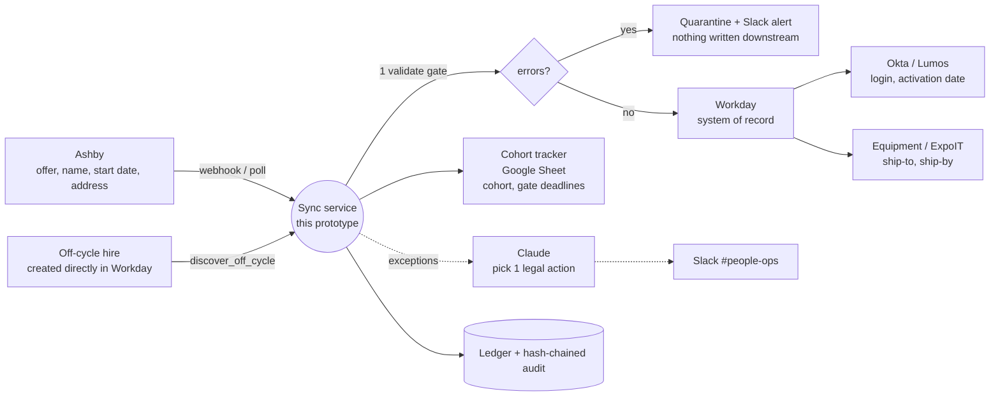

# Systems map (deliverable 1)

Assumptions are marked *(assumed)*: I have no access to BetterUp's real integrations, so the arrows below are the most common patterns for this stack.

## Where the data lives and moves

## Where it breaks today (from the brief)

| Break | Root cause | What the prototype does |
|---|---|---|
| Start date / name / address change after offer doesn't ripple | Manual, per-system, undocumented | One canonical record -> pure projection per system; any change event fans out to exactly the systems whose projection changed |
| Off-cycle hire created outside Ashby | No single entry point | `discover_off_cycle` imports it from Workday and runs the same pipeline, without writing back to Workday |
| Bad name/location cascades into Workday, Okta email, shipping label, tracker | No cross-system check | Validation gate runs first; errors quarantine the hire and leave downstream at last-good state |
| Change arrives after the point of no return (Okta provisioned, label cut, package shipped) | Nobody notices until it's wrong | Deterministic policy lists legal actions; Claude picks one; guard re-checks |
| Deadlines (hardware form, background check, Okta provisioning ~7d out) chased by hand | No computed gates | Gate dates derived from start date and written to the tracker, so a start-date move re-computes them automatically |

## The slice I chose: change propagation (with the validation gate inside it)

- **Why not validation alone:** it blocks bad data but has nothing to do once data is good and *changes*. Most real damage comes from changes landing in some systems and not others.
- **Why not exception monitoring alone:** it needs a source of truth for "what should be true" to detect lateness. Propagation produces that (desired state per system + ledger), so monitoring becomes a cheap read on top (next step, below).
- **Why propagation:** it is the only slice that creates the shared state (canonical hire, ledger, audit) the other two need. Validation is a stage in front of it, and gates/monitoring read the same ledger.

## Existing stack only

Python service + SQLite here; in prod it would run on whatever already hosts automation at BetterUp *(assumed: e.g. a scheduled job or serverless function)*. Slack for alerts, Google Sheet for the tracker, Workday/Okta/Ashby APIs already in place. **No new tools added.** Not adding n8n/Zapier: the hard parts here (idempotency keys, ordering, ledger-based replay, policy guard) are code, not drag-and-drop steps.
